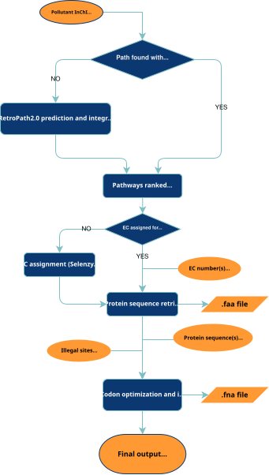

# CAPE — Computational Assistant for Pathway Engineering

> A modular bioinformatics tool for pathway prediction, enzyme selection, and gene optimization.

## Overview

**CAPE** is a modular computational platform designed to assist metabolic pathway engineering.
It supports **pathway retrieval** (KEGG) and **prediction** (RetroPath2.0), **EC number suggestion** (SelenzymeRF), **protein sequences fetching** (NCBI Protein), and **codon optimization** for a target host organism.
Each module can be used independently or combined into a full pipeline.

In addition, the whole Django app can be locally hosted with a user-friendly interface.

## Quick Start

### Local host

To run a local host of the web app, you must have both [Django](https://docs.djangoproject.com/en/5.2/topics/install/) and [conda](https://docs.conda.io/en/latest/miniconda.html) installed.

Then, on a Linux-like terminal:

- Clone the GitHub repository

```bash
git clone https://github.com/andreapolazzi/CAPE.git
```

- Create the conda environment (inside the repository)

```bash
cd CAPE
conda env create -f environment.yml
```

- Activate the environment

```bash
conda activate cape
```

- Run the server

```bash
python manage.py runserver
```

## Installation

If you want to just use the features of the tool without the web-based implementation, follow the instruction as above (Django is not required in this case).

Each module can be used independently from one another, and their outputs can be streamlined by the user as they want.
See the documentation relative to each module below.

### Basic Usage

```bash
python cape.py --input substrate.smi --host rhodococcus
```

## Modules

| Step | Description | Link |
|------|--------------|------|
| 1️⃣ Pathway Prediction | Predicts viable metabolic routes from a starting compound to a desired product. | [Docs →](docs/pathway_prediction.md) |
| 2️⃣ Enzyme Selection | Retrieves enzyme candidates from databases (e.g. KEGG, BRENDA, NCBI Protein). | [Docs →](docs/enzyme_selection.md) |
| 3️⃣ Protein Retrieval | Retrieves and exports protein sequences in FASTA format. | [Docs →](docs/protein_retrieval.md) |
| 4️⃣ Codon Optimization | Adapts coding sequences for the selected chassis organism. | [Docs →](docs/codon_optimization.md) |
| 5️⃣ Export | Exports sequences as FASTA or SBOL for downstream use. | [Docs →](docs/export.md) |

## Pipeline Overview



## Requirements

to do
